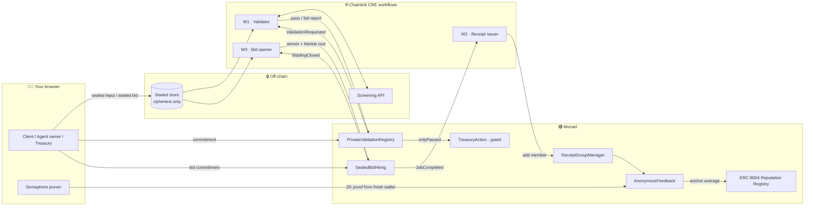

<div align="center">

# 🕶️ Veil8004

### Private attestations for ERC-8004 AI agents

**Hire agents, check them against policy, and rate them, all on-chain, without publishing who did what for how much.**

[](#-live-on-monad-testnet)
[](#-how-it-works)
[](docs/extension-draft.md)
[](#-anonymous-ratings)


[**Quick start**](#-quick-start) · [**Features**](#-features) · [**How it works**](#-how-it-works) · [**Demo walkthrough**](docs/demo.md) · [**Claims and limits**](#claims-and-limits)

</div>

---

## 🤔 The problem

[ERC-8004](docs/extension-draft.md) gives AI agents an on-chain identity, reputation and validation record, so any
contract can ask *"has this agent passed policy P?"* before it acts. The cost is that **everything is public**: who
hired whom, what they paid, which counterparty got screened, and who left which review.

## 💡 The fix

Veil8004 keeps ERC-8004's composability and moves the sensitive parts off the chain. Chainlink CRE workflows act as the
validator, the bid opener and the receipt issuer.

| | 🔓 Plain ERC-8004 | 🕶️ Veil8004 |
|---|---|---|
| **Screening a counterparty** | Name and result on-chain | Salted commitment + pass/fail only |
| **Hiring an agent** | Every quote is public | Sealed bids; losing prices never touch the chain |
| **Proving it to an auditor** | Everything is already public | Disclose *one* request, only when you choose |
| **Rating an agent** | Your wallet signs the review | Zero-knowledge proof you were a real client |
| **Gating a contract action** | `require(passed)` | Same check, without revealing the input |

---

## ✨ Features

### 🛡️ Private validation
An agent or client is screened against a policy (for example "not on the sanctions list"). Only a salted commitment,
the policy id and the result go on-chain. The **W1 validator** workflow decrypts the sealed input, recomputes the
commitment, calls the screening API and reports the result. If the input doesn't match the commitment, the registry
rejects the report.

### 🔐 Composable gate
`onlyPassed` modifiers let any contract require a fresh, matching pass before it runs. The treasury demo action
**passes** on a valid result and **reverts** on missing, failed, expired, wrong-policy, tampered or someone else's results.

### 🏷️ Sealed-bid agent hiring
Clients post tasks, qualified agents submit **sealed bids**, and once bidding closes the **W3 bid opener** awards the
lowest price. The winner's price is checked on-chain against its commitment. Losing prices never reach the chain, and
every loser can prove with a **Merkle inclusion proof** that their bid was counted.

### 🔎 Selective disclosure
The requester exports an **audit bundle** for exactly one validation. The auditor checks it with read-only `eth_call`s
and sends no transaction. Change one character and it fails. The disclosed salt opens nothing else.

### 🗳️ Anonymous ratings
After a completed job, the **W2 receipt issuer** adds the client to a **Semaphore** group for that category and epoch.
The client then rates the agent with a zero-knowledge membership proof from a fresh wallet: one rating per agent per
epoch, enforced by nullifiers. After the rating window, anyone can anchor the average into the official ERC-8004
Reputation Registry.

### 📊 Six-page web app
A dashboard where you play every role, a block explorer that shows **public vs sealed** side by side, an audit
verifier, a gas-cost comparison, and a claims page read directly from the threat model.

---

## 🏗️ How it works



| Workflow | Triggered by | Does |
|---|---|---|
| **W1** Validator | `ValidationRequested` | Decrypts the sealed input, checks the commitment, calls the screening API, reports pass/fail |
| **W3** Bid opener | `BiddingClosed` | Opens every sealed bid, picks the lowest valid one, posts the winner and a Merkle root of all bids |
| **W2** Receipt issuer | `JobCompleted` | Adds the client's Semaphore identity to the receipt group for that category and epoch |

---

## 🚀 Quick start

Everything runs on your machine: a local chain, two small services, the workflow runner and the website.
**No wallet, no testnet funds, no accounts needed.**

```bash
git clone --recurse-submodules https://github.com/MahiVasisth/VeilAgent.git && cd VeilAgent
make install
KEEP=1 make demo      # wait for "Demo complete.", then open http://localhost:3000
```

<details>
<summary><b>🧰 Tools you need (once)</b></summary>

| Tool | Version | Install |
|---|---|---|
| Git | any | usually preinstalled (`git --version`) |
| Foundry (`forge`, `anvil`, `cast`) | recent | `curl -L https://foundry.paradigm.xyz \| bash`, then open a new terminal and run `foundryup` |
| Bun | ≥ 1.4.2 | `curl -fsSL https://bun.sh/install \| bash`, then open a new terminal |
| Node.js | ≥ 22 | [nodejs.org](https://nodejs.org) or `nvm install 22` |
| `curl`, `openssl`, `make`, `python3` | any | preinstalled on macOS and most Linux distributions |

```bash
forge --version && anvil --version && bun --version && node --version
```

Tested on macOS and Linux. On Windows, use [WSL2](https://learn.microsoft.com/windows/wsl/install) (Ubuntu) and run
every command inside it. If you cloned without `--recurse-submodules`, `make install` fetches the submodules for you.
Already have the repo? Run `git pull && make install`.

</details>

Two ways to start. Both build everything the first time (a few minutes; the first run downloads the pinned Semaphore
proving files, so it needs internet once).

| Command | What you get | Open |
|---|---|---|
| `KEEP=1 make demo` | The scripted demo on a fresh chain (~70 s): **28 checks**, every page checked, then everything **left running** with demo data | http://localhost:3000 |
| `make app` | An empty chain, so you can click through the whole flow yourself. `Ctrl-C` stops it | http://localhost:3000/app |

`make demo` prints the process ids to stop it (`Stop with: kill …`) and the path of an audit bundle you can drop on
the Verify page.

### 🖥️ The pages

| Page | URL | What you'll see |
|---|---|---|
| 🏠 **Home** | `/` | Animated hero, a live **Try it** box (screen a company privately and watch the 4 steps), and a **Flip the lens** public/private toggle |
| 📋 **Dashboard** | `/app` | Sign in as a demo account (Atlas, Borealis, Cirrus, Client A, Client B, Treasury desk): Overview, Hire, Find work, Screening, Vault |
| 🏷️ **Auctions** | `/auction` | Task cards with 🔒 sealed bids and the winner in green; *On-chain proof* folds open |
| 🔭 **Explorer** | `/indexer` | Block-explorer view: live stats, a searchable activity feed (click any event to see what's on-chain and what stayed sealed), an agents directory, and side-by-side plain ERC-8004 vs Veil8004 tabs |
| ✅ **Verify** | `/audit` | Drop an audit bundle and see **Verified**; edit one character and watch it fail |
| ⛽ **Gas costs** | `/costs` | Gas per operation, ERC-8004 vs Veil8004 |
| 📜 **Security claims** | `/claims` | Everything the project claims, and everything it doesn't |

The **Demo network** chip on each page explains what is simulated on the local chain.

<details>
<summary><b>🎮 Play the whole flow yourself (7 steps)</b></summary>

You play several people. Switch accounts with the icon at the top right of the dashboard.

| # | Sign in as | Tab | Do |
|---|---|---|---|
| 1 | **Atlas** | Find work | Credential `QS-2026-0417` → **Get qualified** |
| 2 | **Borealis** | Find work | Credential `QS-2026-0582` → **Get qualified** |
| 3 | **Client A** | Hire | **Post task** (Sanctions screening, 10 min) |
| 4 | **Atlas**, then **Borealis** | Find work | Type a price on the open task → **Place sealed bid** |
| 5 | anyone | sidebar, then Hire | Click **+10m** (sidebar) to pass the deadline, then **Close bidding** on the task. Wait about 5 seconds: the sealed bids are opened and the lowest wins |
| 6 | **Client A** | Hire | **Mark job completed**, wait about 5 seconds for the rating receipt, then **Rate anonymously** |
| 7 | **Treasury desk** | Screening | Screen `Northwind Trading LLC` → **Export for audit**, then drop the file on **Verify** |

After each step, open **Auctions** or **Explorer** to see what the public sees. After `make demo`, the agents show
**Expired** because the scripted demo fast-forwards the chain clock: qualify them again with steps 1 and 2 before
bidding.

Fictional test data: the sanctions list flags *Kestrel Shipping Co*, *Blackfin Holdings Ltd* and *Orrin Maritime SA*.
Valid credentials are `QS-2026-0417`, `-0582`, `-0733` and `-0901`.

</details>

<details>
<summary><b>🛠️ Editing the frontend</b></summary>

With `KEEP=1 make demo` running, stop its production web server and start the dev server, which reloads on every save:

```bash
pkill -f next-server                                  # stops only the website; the chain and services keep running
set -a; source <the public-keys.env path the demo printed>; set +a
cd frontend && bun run dev                            # http://localhost:3000
```

Without the `source` line everything works except sealing to the real workflow keys, so posting screenings and bids
from the app fails, and the home page's *Try it* box seals to a throwaway key instead.

Run `bun run build` in `frontend/` before committing to catch type errors, and `make demo` to re-run every page check.

</details>

<details>
<summary><b>🩺 Troubleshooting</b></summary>

| Problem | Fix |
|---|---|
| `something is already listening on http://127.0.0.1:8545` or `… is in use` | An earlier run is still going. Stop it with the `kill …` line it printed, or `pkill anvil; pkill -f next-server; pkill -f sealed-store; pkill -f mock-screening; pkill -f local-runner` |
| Page says **We couldn't reach the network** | The chain isn't running. Start it again |
| `missing anvil` / `missing bun` | Install the tool and open a new terminal |
| Demo accounts don't appear on the sign-in screen | They only show on the local chain (31337) |
| The data is gone after a restart | Expected: every run starts a fresh chain |
| Proving files fail to download | Check your internet connection and run `make artifacts` once |
| *Find work* shows "Atlas needs a qualification to bid" | Do steps 1 and 2 first (agents show **Expired** after `make demo`) |
| **Close bidding** doesn't appear | The deadline hasn't passed yet: click **+10m** in the sidebar |
| A button seems to do nothing | Look for the message in the bottom-right corner; errors stay until you close them |

</details>

---

## 🟣 Live on Monad testnet

The contracts are deployed on Monad testnet (chain `10143`) against the live ERC-8004 Identity and Reputation
registries and the real CRE forwarder. The full list is in
[`contracts/deployments/10143.json`](contracts/deployments/10143.json).

| Contract | Address |
|---|---|
| PrivateValidationRegistry | `0x57c009367F590f0Fe27c31166DA32639a5987FAF` |
| SealedBidHiring | `0x5482EE07e980d30558bb60085Bbc64425fA2555e` |
| ReceiptGroupManager | `0x8AAa3b7b07C2e539395cb106A084e985b59abc59` |
| AnonymousFeedback | `0xdb8addbE17eeE8716516E2d39f22bc564c1a89D1` |
| PolicyRegistry | `0x96a96A34E43571B59e78F5139d0f2C86E3E45A4A` |
| TreasuryAction (gated) | `0x931Ae12d32abb86Fb63508ac03117E4aB1F1a44d` |
| Semaphore | `0xD66200834e64f4aC90AD1fd1822dE96E3b29C126` |

```bash
DRY_RUN=1 make deploy-testnet   # rehearse on a local fork of Monad testnet; spends nothing
make deploy-testnet             # the real deployment; needs a funded DEPLOYER_PRIVATE_KEY and TREASURY_OPERATOR in .env
```

---

## 🎭 What's real and what's simulated

> [!IMPORTANT]
> This README makes no claim beyond the [claims table](#claims-and-limits) below.

| | Status |
|---|---|
| Contracts, commitments, sealed bids, Merkle proofs, Semaphore proofs, audit bundles | ✅ **Real**, tested |
| **The CRE DON** | 🧪 **Simulated.** A local runner (`cre/local-runner`) runs the same W1, W3 and W2 handler code as the CRE workflows and delivers reports through a **MockForwarder**. It has no consensus, no report signatures and no enclave, and it reads the screening API key from env rather than through Confidential HTTP. The three CRE workflows are written and compile to WASM, but have not been run under `cre workflow simulate` or deployed |
| **The screening provider** | 🧪 **Mock** API with a fictional hit list and fictional credentials |
| **Part of the anonymity set** | 🧪 The population simulator (`scripts/src/simulator.ts`) adds simulated clients so a receipt group isn't one person. Their rows are labeled `simulated` |
| **Names, counterparties, credentials, prices** | 🧪 Fictional demo data |
| Hiding inputs from CRE node operators (Confidential Workflow) and API credentials (Confidential HTTP) | 📐 **Designed, not demoed** |

Salts, bid prices and rating identities are created in your browser and stay in its local storage (exportable under
**Vault**). Rating proofs are generated in your browser. The app's server only forwards ciphertext to the sealed store
and relays finished rating proofs.


---

## 🧪 Build, test and run each phase

```bash
cp .env.example .env
make build
make test            # 146 Foundry tests + 117 Bun tests
```

Every phase has a one-command exit check that starts from a clean Anvil. Add `KEEP=1` to leave everything running.

| Command | Proves | Page |
|---|---|---|
| `make phase1` | **Public baseline:** the indexer rebuilds the full client, agent, payment, score and validation graph from public events. This is what Veil8004 hides | `/indexer` |
| `make phase2` | **Private validation + gate:** the treasury action passes on a valid result and fails on missing, failed, expired, wrong-policy, tampered and foreign results. Replays and non-forwarder callers are rejected; the chain is leak-scanned for every input and salt | `/indexer` |
| `make phase3` | **Sealed-bid hiring:** an unqualified agent is rejected; duplicate, early-close and late bids are rejected; W3 awards the lowest; losers verify Merkle inclusion; the full Anvil state is leak-scanned for losing prices and salts | `/auction` |
| `make phase4` | **Selective disclosure:** bundles with a different input, salt, agent, policy, chain or registry are rejected; a dictionary attack with the disclosed salt opens nothing else | `/audit` |
| `make phase5` | **Anonymous ratings:** double ratings, non-members, out-of-range scores, wrong scopes and late ratings are rejected; the average is anchored into the ERC-8004 Reputation Registry | `/indexer` |
| `make demo` | **Everything:** the spec's demo script, 28 checks, every page | `/` |

<details>
<summary><b>⌨️ Command-line tools</b></summary>

```bash
# Sealed bids
bun scripts/src/bidder.ts bid --task 1 --agent 0 --price 4217350000000000000000   # needs W3_PUBLIC_KEY, a running store
bun scripts/src/bidder.ts inclusion --task 1 --agent 0                            # public data only

# Audit (read-only; exit 0 = verified, 1 = not verified, 2 = malformed)
bun scripts/src/auditor.ts bundle.json
bun scripts/src/auditor.ts bundle.json --json

# Anonymous ratings
make artifacts                                                          # once: fetch the pinned Semaphore artifacts
bun scripts/src/rater.ts identity --out me.identity                     # commitment to pass to postTask
bun scripts/src/rater.ts rate --task 1 --score 5 --identity me.identity # proves offline, sends from a fresh wallet

# Grow the anonymity set (against a running KEEP=1 make demo, after sourcing its public-keys.env)
make simulate CLIENTS=6 [RATE=1]
```

The audit bundle contains the salt. Anyone who holds it can verify the request and pass it on, so give it only to the
auditor. Secrets for a run (workflow key pairs, store token, API key) are generated fresh per run and never written to disk.

</details>

---

## Claims and limits

| Property | Claimed? | Notes |
|---|---|---|
| Validation input hidden from chain observers | Yes | Salted commitment only |
| Input bound to the on-chain commitment | Yes | W1 recomputes it and the registry rejects a mismatch |
| Validation input hidden from CRE node operators | Only with a Confidential Workflow | In a standard workflow the nodes decrypt the payload |
| Validator API credentials hidden | Yes | Confidential HTTP |
| Losing bid prices hidden from chain observers | Yes | Never opened on-chain |
| Bids hidden from CRE node operators | Only with a Confidential Workflow | W3 sees every bid |
| Winner and winning price | Not hidden | Public by design |
| Which agents bid | Not hidden | Bidder addresses are visible; a relayer is future work |
| Winner's bid matches its commitment | Yes | Checked on-chain |
| The winner was the lowest valid bid | Trusted to W3 | The chain cannot check it without opening losing bids; losers can only prove inclusion |
| Bidder collusion | No | Out of scope |
| Selective disclosure to an auditor | Yes | One request, when the requester chooses |
| Forced disclosure by a third party | No | Only the requester holds the salt |
| Rater unlinkable to wallet | Yes, within the group's anonymity set | Small groups give weak anonymity; the client's identity commitment is public at postTask |
| Rater actually used the rated agent | Partly | The proof shows a completed job with some agent in that category and epoch, and that the rated agent had one too |
| Individual scores | Not hidden | Only the rater is hidden |
| Linking through the rating transaction | Mitigated by a relayer or fresh wallet | State the residual risk |
| Receipt farming by a colluding agent | Raised in cost, not eliminated | Each receipt needs an awarded, completed job |
| Payment rail privacy | No | Out of scope |
| Gated action visibility | No | The action itself is public |
| Assurance tier enforcement | No | Recorded and displayed; enforcement is specified in the extension draft |
| Simulated clients | Disclosed | The demo's anonymity set is partly simulated |


---

## 🗂️ Layout

```
contracts/   Foundry project (src/{interfaces,core,consumers,receipts,mocks}, test/, script/)
cre/         handlers/ (pure), workflows/ (CRE wiring), local-runner/ (DON simulation)
services/    sealed-store/, mock-screening/ (MOCK)
sdk/         commitments, seal, bids, merkle, disclosure, semaphore, claims, indexer views
scripts/     client, bidder, auditor, rater, demo, simulator, deploy-testnet, phase exit checks
frontend/    home (live demos), app dashboard, auctions, explorer (indexer view), verify (audit), costs, claims
docs/        SPEC.md, phase0.md, threat-model.md, extension-draft.md, demo.md, writeup.md, submission.md
```

## 📚 Docs

| | |
|---|---|
| 🎬 [Demo walkthrough](docs/demo.md) | For someone seeing it cold |
| 📐 [Build spec](docs/SPEC.md) | The full design |
| 🧱 [ERC-8004 extension draft](docs/extension-draft.md) | The extension these contracts propose |
| 🛡️ [Threat model](docs/threat-model.md) | What is claimed and what isn't |
| 🔍 [Phase 0 findings](docs/phase0.md) | Research notes and open items |
| ✍️ [Write-up](docs/writeup.md) | The project story |
| ✅ [Submission checklist](docs/submission.md) | What's done and what's left |

<div align="center">

**Built with** Foundry · Bun · Next.js · Chainlink CRE · Semaphore V4 · Monad

</div>
